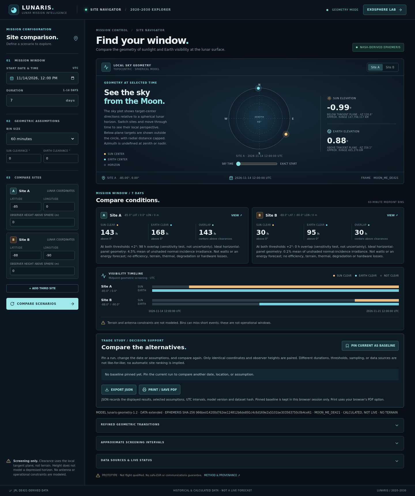

# Lunaris — lunar landing site navigator & environment lab

**A NASA Space Apps Challenge concept for exploring lunar surface conditions.**
I built Lunaris to practise turning open planetary observations and space-physics assumptions into an understandable mission-planning interface, especially for lunar solar-power and surface-operation questions. The aim is to prepare a challenge-ready project that connects science, software and practical engineering. This is a personal prototype, not an official NASA product; it does not claim that it was submitted, selected, endorsed, or awarded.



**Important:** Models are illustrative and unvalidated. The historical Diviner subset is not live telemetry. Do not use any output for mission, equipment or EVA decisions. [Read the complete self-audit and roadmap](AUDIT.md).

## Site Navigator — Phase 1 status

**Phase 1 is not complete.** This implementation compares 1–3 sites from 2020 through 2030 using a checksum-gated, project-generated table of JPL DE421/NAIF-derived Moon-fixed geometric vectors. It interpolates direction and range separately, computes topocentric Sun and Earth target-center directions and approximate ranges on a spherical Moon, and reports approximate 15-, 30-, or 60-minute midpoint sunlight, Earth-visibility and overlap bins and intervals above chosen fixed clearance angles. Refined threshold transitions use a 15-minute sign scan and one-second bisection bracket; brief or grazing events can be missed, and the bracket is not a physical accuracy guarantee. It does not call Horizons live and does not use current lunar observations. The original third-party 2026 table is a fallback when the extended table fails verification. UTC predictions depend on the pinned leap-second kernel and cannot anticipate future leap seconds. The UI and API support three editable sites. A simple horizontal-panel geometry indicator averages `max(0, sin(solar elevation))`, relative to unshaded normal-incidence irradiance. It is **not electrical power or an energy prediction**: terrain, efficiency, panel temperature, degradation and hardware are not modeled.

The optional server-side DONKI CME query is disabled by default. Set `LUNARIS_DONKI_ENABLED=1` before starting the server to enable an on-demand external request; cached responses include their actual fetch time and may be up to ten minutes old. NASA DONKI events are research context, not a lunar radiation or mission safety forecast. Network failure returns unavailable, not simulated data. Without network access the bundled geometry and Diviner sample still work once dependencies have been installed.

The separate optional terrain screen uses a coarse third-party LOLA-derived south-polar raster, but does not establish actual horizons or verified visibility. Complete Diviner coverage, LADEE observations, live Horizons ingest, full pipeline, global uncertainty analysis, expert validation and public deployment are absent. See [ephemeris provenance and geometry limits](data/ephemeris/README.md) and [self-audit](AUDIT.md). This is a screening prototype, not flight-qualified, and is not an EVA or communication guarantee.

## Try the prototype

There is **no public hosted demo yet**. GitHub shows the source code, not a running backend. The fastest no-install option for a reviewer with a GitHub account is Codespaces; it may require an available usage quota or payment.

### Option A — open in GitHub Codespaces

1. [Create a Lunaris Codespace on this working branch](https://codespaces.new/hariszafar740-lang/hariszafar740-lang?ref=arena/4e302a25-hariszafar740-lang). Sign in and choose the **Lunaris — lunar environment lab** configuration if prompted.
2. Wait for the dev container to install the Python and Node dependencies and build the frontend. The server should start automatically. Open the forwarded **Lunaris prototype** port 8000 from the Ports tab if a browser tab does not open.
3. If startup fails, inspect `/tmp/lunaris-codespaces.log` in the Codespace terminal and run `cd lunar-envelope && HOST=0.0.0.0 ./run.sh`. Stop or delete the Codespace afterward to avoid unnecessary usage.

This Codespaces configuration is supplied but has **not been tested on GitHub infrastructure** in this environment. Its forwarded link is normally private to the Codespace user and is not a substitute for a public demo.

### Option B — Docker (Windows, macOS, or Linux)

Install Git and Docker Desktop (or Docker Engine), then run these commands in a terminal. The browser app and Python API run together; no local Node or Python install is needed:

```bash
git clone --branch arena/4e302a25-hariszafar740-lang --single-branch https://github.com/hariszafar740-lang/hariszafar740-lang.git
cd hariszafar740-lang
docker build -t lunaris ./lunar-envelope
docker run --rm -p 127.0.0.1:8000:8000 lunaris
```

Open [http://127.0.0.1:8000](http://127.0.0.1:8000). Stop with Ctrl+C. Docker builds need access to Docker Hub, PyPI and npm. The recipe has **not been built or tested here** because Docker is unavailable in this workspace.

### Option C — native installation (Linux, macOS, Windows)

Requires Git, Python **3.11+**, Node.js **20+** and npm. From a fresh checkout:

```bash
git clone --branch arena/4e302a25-hariszafar740-lang --single-branch https://github.com/hariszafar740-lang/hariszafar740-lang.git
cd hariszafar740-lang/lunar-envelope
```

On **Linux or macOS** (a POSIX shell):

```bash
./run.sh
```

On **Windows PowerShell**, from the `lunar-envelope` directory:

```powershell
py -3.11 -m venv .venv
.\.venv\Scripts\python.exe -m pip install --upgrade "pip>=26.2" "setuptools>=84.1.0"
.\.venv\Scripts\python.exe -m pip install -r backend/requirements.lock
Push-Location frontend
npm.cmd ci
npm.cmd run build
Pop-Location
.\.venv\Scripts\python.exe -m uvicorn backend.main:app --host 127.0.0.1 --port 8000
```

Windows users can replace `py -3.11` with another installed Python 3.11+ executable. Open [http://127.0.0.1:8000](http://127.0.0.1:8000) and stop with Ctrl+C. The Linux shell path was tested; macOS and Windows instructions have **not** been executed here. On Linux, Python's venv package may need separate installation. First-time installs require PyPI and npm access. The default binds to localhost only; set `HOST=0.0.0.0 PORT=8001 ./run.sh` when network exposure is intentional. Use a firewall and never treat this development server as production hosting.

### A 90-second walkthrough

1. In the Site Navigator, edit the UTC window, bin size, clearances and up to three sites; choose **COMPARE SCENARIOS**. Move the sky-time slider, pin a baseline, change a date or threshold and compare again. Export JSON or print/save the current result as PDF. Open **EXOSPHERE LAB**, then **GUIDED TOUR**, and select a point or enter coordinates. The globe texture is procedural, not a lunar map.
2. Change lunar phase or run a hypothetical stress test; inspect the model output and the 30-day screening strip.
3. In **Diviner archive**, select **GO TO SAMPLE SITE** to see a historical observation next to an approximate-local-time model estimate. It is not a validation.
4. Download a **CSV** or **PDF** report. Candidate intervals are screening indicators, **not safe EVA windows**.

## Development and tests

With dependencies installed, start the backend from this directory using `.venv/bin/python -m uvicorn backend.main:app --host 127.0.0.1 --port 8000`, and run `npm run dev` from `frontend` in another terminal. Vite proxies `/api` to the backend. Backend tests: `.venv/bin/pip install pytest httpx && .venv/bin/python -m pytest -q tests`; frontend: `npm run build` from `frontend`. With the app running and Chromium installed, run `CHROMIUM_PATH=/path/to/chromium npm run test:e2e` from `frontend`. The GitHub Actions workflow passed for commit `7109b63` ([run](https://github.com/hariszafar740-lang/hariszafar740-lang/actions/runs/43580779798)); check the latest run for later changes.

## What the legacy exosphere model does

All inputs are bounded; the backend is deterministic. Longitude zero is the subsolar point at phase zero; the subsolar longitude travels 360° over a 29.53-day synodic cycle and latitude is fixed at zero. This simplified phase convention is not an ephemeris. No terrain or axial tilt is included. Temperature uses `T⁴ = 95⁴ + max(cos θ,0) (390⁴−95⁴)` K. A scalar current-balance proxy solves electron, ion, and photoelectron currents by bisection. Their amplitudes and characteristic energies are illustrative, not fitted. Neutral species use a simple isothermal barometric scale height `H=kT/(mg)` and illustrative surface abundances; it is not the full Chamberlain model and does not model sputtering or photoionization losses.

Dust concentration and deposition are empirical proxies for meteoroid flux and proximity to the terminator. A 1 μm grain charge and electric-force **magnitude** are compared with gravity plus an assumed cohesion, using an assumed 5 cm field length. This is not a directional loft solution, and the proxy dust concentration is not derived from that force comparison. The solar curve advances lunar phase in six-hour steps and integrates the illustrative deposition rate D in g/m²/day. Retention is `100 exp(-0.8 ∫D dt)` with assumed extinction coefficient 0.8 m²/g. Wind, UV and meteoroid inputs remain fixed during the projection. The risk strip and candidate intervals only screen the proxy thresholds and sunlight; they are not safe-EVA windows. Hazard categories are arbitrary screening thresholds, not validated risk or safe-EVA windows. Presets represent hypothetical slider combinations, not event reconstructions. The lunar texture, particle cloud and shell rings are schematic, not maps or 3D solver grids. Their visual appearance does not constitute a measurement.

## NASA data status

The project includes a **small historical LRO Diviner subset**: 551 binned brightness-temperature observations and the original PDS4 label, retrieved from a pinned GitHub mirror. The API validates the source-file checksums and schema and returns the nearest bin only within 2 km. Choose **GO TO SAMPLE SITE** to see one in the inspector and report. The sample is spatially sparse and records historical observing conditions; it is not a live feed, a global map, or a time-matched validation of the simulation. The model's temperature remains an independent grey-body proxy; no observation is used to calibrate it. NASA PDS could not be reached directly, so the mirror's claimed extraction has not been independently checked against the full NASA table. Product links, hashes, attribution, selection limitations, and provenance are in [data/diviner/README.md](data/diviner/README.md).

The runtime Python versions are listed in `backend/requirements.lock`; the lock has platform markers and is not hash-locked. An optional generic utility accepts a *previously normalized* CSV with columns `timestamp,quantity,value,unit,source_url`: `.venv/bin/python backend/ingest.py /path/to/normalized.csv`. It checks basic formatting and a NASA/PDS-related URL domain; it is not a PDS parser and cannot verify provenance. Its output is not used by the Diviner endpoint or simulation. Full product ingestion, LADEE observations, broad Diviner coverage, and scientific calibration remain future work.

Physical context: [NASA Moon fact sheet](https://nssdc.gsfc.nasa.gov/planetary/factsheet/moonfact.html); [NASA LADEE mission](https://science.nasa.gov/mission/ladee/). Further model validation and independent scientific review are required.

## Terrain roadmap Step 2 — partial implementation

A separate optional terrain panel screens one selected site at 80–90°S using a checksum-gated 400 m third-party LOLA-derived raster. It calculates a sampled, curvature-aware azimuth horizon and plots midpoint Sun/Earth-above-sampled timelines. This does **not** change the original spherical comparison or use its fixed clearances. Missing near and far terrain, coarse averaging, uncertainty and interpolation can change results: above-sampled is not proven clear. Data provenance, methods, independent-code cross-checks and large observed differences are in [terrain documentation](data/terrain/README.md). **Step 2 is not complete** against the requested independently audited 10/10 standard; no independent expert audit was obtained. Neither scientific validity nor winning a competition can be guaranteed.

## Phase 2 features and gaps

Phase 2 is **not complete**. The navigator now has a sky-time scrubber, three sites, fixed clearance thresholds, configurable midpoint resolution, a +2° sensitivity comparison, pinned date/assumption baseline, coordinate-matched trade table, reproducible JSON export and browser print/PDF. The thresholds are abstract angles, not terrain horizons, and the sensitivity test is not an uncertainty interval. The horizontal-panel geometry fraction uses an unobstructed 0° horizon independently of the clearance thresholds. Baselines remain in browser memory only; JSON contains both snapshots and their inputs, frame, model version, dataset hash and limitations. Differences between different durations, coordinates or assumptions do not establish a winning site. [Demo outline and references](docs/DEMO.md) are ready to adapt, not a completed challenge submission.

The legacy lab's Guided Story Mode and Diviner comparison remain available; its physics is illustrative, not a validated NASA-data model. Scientific expert review, verified original LOLA/terrain ingestion, validated system and power constraints, a public demonstration, user testing and a completed official submission remain absent. No one can guarantee a win or honestly award an independent 10/10 without an actual independent reviewer. See [AUDIT.md](AUDIT.md).

The product-specific ingestion tool can extract a bounded selection from the bundled sample or the original full, checksum-matched product (see the pinned URLs in `data/diviner/README.md`):

```bash
.venv/bin/python -m backend.diviner_ingest --table data/diviner/diviner_subset.tab --mode subset --output data/extract.csv --south -90 --north -88
```

It writes a separate provenance JSON and refuses an existing output; use `--mode full` for the original full table only. It cannot ingest LADEE or arbitrary PDS products. The row limit defaults to 10,000 and must be set explicitly up to 100,000. Extraction does not automatically add data to the app.

### Deployment

`docker build -t lunaris lunar-envelope` from the repository root and `docker run --rm -p 8000:8000 lunaris` run the frontend and API together. The container supports a `PORT` environment variable for platforms that assign one. This recipe is provided for deployment; it has not been deployed publicly. Use an HTTPS-capable hosting service, review security and resource limits, and do not expose the server directly without appropriate protection. GitHub Pages alone cannot run the Python API.

## API

- `POST /api/compare-sites` — geometric site comparison; accepts timezone-aware `start`, `days` (1–14), 1–3 named sites with latitude/longitude and optional observer `height_m` (0–1000 m above the reference sphere), optional `step_minutes` (15, 30 or 60), and optional `sun_clearance_deg` / `earth_clearance_deg` (0–10). Full interval must fit 2020-01-01 through 2031-01-01 UTC; if the extended dataset is unavailable, only its 2026 fallback interval is usable. The height model uses a local tangent-plane threshold and does not model horizon dip.
- `POST /api/terrain-screen` — optional coarse south-polar sampled-horizon screening for one site and date range; observer height is above interpolated terrain. See [terrain limitations](data/terrain/README.md).
- `GET /api/data-catalog` — available, disabled or unavailable data sources.
- `GET /api/space-weather?days=7` — optional DONKI CME event context; disabled unless enabled on the server.
- `GET /api/health` — readiness
- `POST /api/simulate` — accepts `phase`, `wind`, `uv`, `meteor`, `latitude`, `longitude`; returns model outputs and a 30-day curve.
- `GET /api/nasa-data` — reports availability and provenance of the bundled subset.
- `GET /api/diviner?latitude=...&longitude=...` — nearest historical bin only within 2 km.
- `POST /api/diviner-comparison` — approximate local-time comparison with caveats.
- `POST /api/export-report` and `POST /api/export-report.pdf` — CSV timeline or PDF summary.

## Audit and known gaps

Functional checks cover inputs, day/night behavior, bounded results, scenario response, CSV consistency, basic ingestion, frontend build and API availability. These tests do not validate the physical model. Phase 2 is incomplete: LADEE data, full-product verification, scientific validation and actual deployment remain outstanding. See `AUDIT.md`. Additional desired work includes labeled product parsers, actual mapped albedo/topography and Diviner temperatures, scientifically validated dust/plasma physics, browser compatibility and accessibility audits, and mission-risk validation. No claim of competition success or 10/10 quality is justified.
